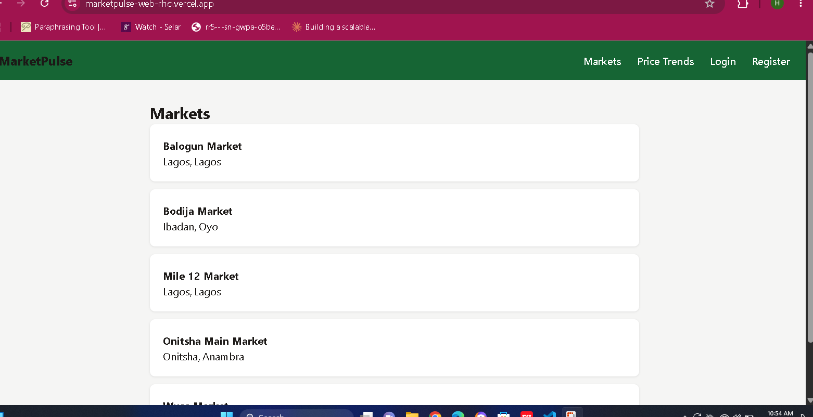

# MarketPulse — Frontend 🛒

The React frontend for **MarketPulse**, a crowdsourced local market price index for Nigerian markets. This app lets anyone browse live price trends, register and submit real price reports, and — for admins — manage which markets and commodities are tracked.

**🔗 Live app:** https://marketpulse-web-rho.vercel.app/
**🔗 Live API this app talks to:** https://marketpulse-api-6t20.onrender.com/api/v1/docs
**🔧 Backend repo:** [marketpulse-api](https://github.com/hadihassan4peace-wq/marketpulse-api)

<!-- Add screenshots here, e.g.: -->
 
<!--  -->

---

## What it does

- **Browse markets** — see every market currently tracked, with city/state
- **View live price trends** — average, min, max price per commodity, computed from real crowdsourced data
- **Register / Login** — JWT-based auth, session persists across page refreshes
- **Submit a price report** — any logged-in user can report what a commodity actually sold for at a specific market
- **Admin panel** — admins can add new markets and commodities directly through the UI
- **Route protection** — logged-out users are redirected away from pages requiring auth; non-admins can't reach the admin panel

## Tech stack

| Layer | Technology |
|---|---|
| Framework | React 19 + TypeScript |
| Build tool | Vite |
| Routing | React Router |
| HTTP client | Axios (with an auth interceptor that auto-attaches JWTs) |
| State | React Context (auth state) + local component state |
| Deployment | Vercel |

## Running locally

```bash
git clone https://github.com/hadihassan4peace-wq/marketpulse-web.git
cd marketpulse-web
npm install
```

Create a `.env` file in the root:
```
VITE_API_URL=https://marketpulse-api-6t20.onrender.com/api/v1
```
(or point it at `http://localhost:5000/api/v1` if you're also running the [backend](https://github.com/hadihassan4peace-wq/marketpulse-api) locally)

```bash
npm run dev
```

App runs at `http://localhost:5173`.

## Project structure

```
src/
  api/           # Axios client with auth interceptor
  components/    # Reusable components (ProtectedRoute)
  context/       # AuthContext — shared login state across the app
  pages/         # Markets, Stats, Login, Register, Submit Report, Admin
  types/         # TypeScript types matching the backend's data shapes
```

## How auth works

On login/register, the API returns a JWT and the user's profile. Both are stored in `localStorage` via `AuthContext`, and an Axios request interceptor automatically attaches the token to every outgoing request as `Authorization: Bearer <token>`. Routes needing auth (or a specific role) are wrapped in a `<ProtectedRoute>` component that redirects unauthenticated or unauthorized users before the page ever renders.

## What I learned building this

This is the frontend half of a full-stack project I built end to end — the [backend](https://github.com/hadihassan4peace-wq/marketpulse-api) first, then this. Building this half meant learning React's data-fetching and form patterns from scratch, wiring a real auth flow against a live API, and working through real deployment issues: TypeScript's stricter CI-time type checking catching things the dev server didn't, and a tricky duplicate-project mixup on Vercel that took some real debugging to untangle.

---

Built by Hassan · [Backend repo](https://github.com/hadihassan4peace-wq/marketpulse-api)
